<p align="center">
  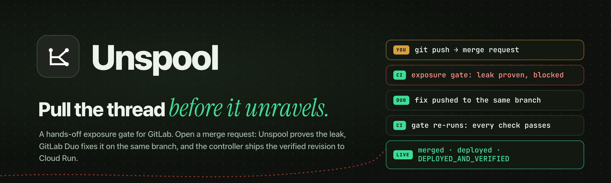
</p>

<div align="center">
  <h1>UNSPOOL</h1>
  <p><strong>A hands-off exposure gate for GitLab: open a merge request, and a leaked secret is proven, fixed by GitLab Duo, and shipped verified, with nobody in the middle.</strong></p>
  <p><em>Every sensitive field leaves your code on a thread: from where it is born to where it is sent.<br>Unspool pulls that thread before it unravels in production.</em></p>
  <p>
    <a href="submission/submission-description.md"></a>
    <a href="https://gitlab-transcend.devpost.com/"></a>
    <a href="https://unspool-398376578726.us-central1.run.app"></a>
    <a href="https://unspool-demo-398376578726.us-central1.run.app"></a>
  </p>
  <p>
    <a href="LICENSE"></a>
    
    
    
    
  </p>
  <p>
    
    
    
    
    
    
  </p>
  <p>
    <a href="submission/submission-description.md">Submission</a> ·
    <a href="submission/assets/unspool-loop.gif">The hands-off loop</a> ·
    <a href="#the-proof-run-mr-44">Proof run</a> ·
    <a href="#nine-devsecops-stages">Nine stages</a> ·
    <a href="submission/technical-notes.md">Technical notes</a> ·
    <a href="JUDGE_GUIDE.md">Judge guide</a>
  </p>
  <p><sub>git push → exposure gate proves the leak → GitLab Duo fixes it on the same branch → gate passes → merged, deployed, live revision confirmed</sub></p>
</div>

> [!IMPORTANT]
> The loop below ran for real on this project: [MR !44](https://gitlab.com/gitlab-ai-hackathon/transcend-october-2026/43244671/unspool/-/merge_requests/44) went from one `git push` to a verified Cloud Run deployment in about 8.5 minutes with no human action after the push. The Unspool controller runs on the operator's machine with their existing `glab` login (it is the only identity allowed to merge); GitLab Duo writes every fix; the gate's typed decision model is a third-party API. The demo target is a small synthetic service, and automatic promotion is limited to the files an operator allowlists. See [Truth boundaries](#truth-boundaries).

<details>
<summary><kbd>Contents</kbd></summary>

- [At a glance](#-at-a-glance)
- [The problem](#the-problem)
- [The hands-off loop](#the-hands-off-loop)
- [The proof run: MR !44](#the-proof-run-mr-44)
- [How Unspool decides](#how-unspool-decides)
- [What Unspool does](#what-unspool-does)
- [Results](#results)
- [Nine DevSecOps stages](#nine-devsecops-stages)
- [Path B: before and after](#path-b-before-and-after)
- [How the system is built](#how-the-system-is-built)
- [Try it](#try-it)
- [Run locally](#-run-locally)
- [Verify](#verify)
- [Truth boundaries](#truth-boundaries)
- [Repository map](#repository-map)
- [License and attribution](#license-and-attribution)

</details>

## 🧵 At a glance

<table>
  <tr>
    <td width="25%" align="center"><strong>01 / PUSH</strong><br><br>A developer opens a merge request. That is the only human step.</td>
    <td width="25%" align="center"><strong>02 / PROVE</strong><br><br>The exposure gate traces sensitive fields, asks a typed decision model where to look, and fires canary probes. A leak is proven, not guessed.</td>
    <td width="25%" align="center"><strong>03 / FIX</strong><br><br>The controller starts GitLab Duo through the Agent Platform API with the evidence. Duo pushes the fix to the same branch.</td>
    <td width="25%" align="center"><strong>04 / SHIP</strong><br><br>Every check re-runs. The controller merges the exact revision, waits for Cloud Run, and confirms the live revision.</td>
  </tr>
</table>

<p align="center"><sub>Tests pass. Reviews pass. Nobody pulls the thread. Unspool does, on every merge request.</sub></p>

## The problem

Somewhere in your API, a field is leaving that never should. Not a breach: one `password_hash` riding along in a public response, or a card number written to a log.

These leaks survive everything teams already run. In our demo the change is one line, `fields = record.get("columns", fields)`, added so legacy CSV imports show a customer handle. Static analysis finds nothing. All 162 tests pass. Code review approves it. Only a legacy import row, one that carries its own column list, turns the public profile into the whole record.

AI coding agents make this worse and better at once. In our benchmark, 14 of 36 agent-written fixes passed every test and still leaked. Agents can also fix leaks quickly, but only if something proves the leak first and only if their fix is checked by something other than the agent.

Unspool asks one narrow question on every merge request:

> Does any sensitive value leave this revision where it should not, and if it does, can GitLab Duo fix it and ship it without a person in the middle?

## The hands-off loop

<p align="center">
  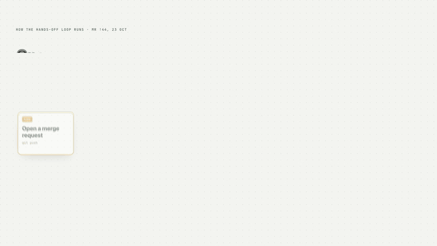
</p>

| Stage | What happens | What cannot happen silently |
| --- | --- | --- |
| **Push** | A developer pushes a branch and opens a merge request to `main`. | Nothing else is required: no label, no comment, no button. |
| **Gate** | GitLab CI runs the tests and `verify-exposure`: static tracing, a typed decision model for unclear boundaries, and configured canary probes in isolation. | A gate that fails without producing evidence stops the run; Duo is never asked to fix a leak that was not found. |
| **Hand-off** | The watching controller sees the blocked revision and starts GitLab Duo's Developer flow through the Duo Agent Platform API, on the MR's own branch, with the verdict: boundary, probe, field, sink. | No @-mention trigger; the session is recorded on the MR. Duo is never given merge rights. |
| **Fix** | Duo pushes a fix to the same branch; the pipeline re-runs by itself. Still blocked after two Duo attempts? The item stops. | Changes outside the operator's allowlist (CI, tests, policy, tooling) are never promoted. |
| **Ship** | The controller checks the complete diff, the exact revision, every required job and the independent evidence, merges, waits for the protected-`main` pipeline (signing, attestation, Cloud Run, Pages, smoke), and confirms the live revision. | Missing, failed or unknown means stopped, never a successful deployment. |

## The proof run: MR !44

One push on 23 October 2026, then nothing. Every row below is a real GitLab record.

| UTC | Step | Who |
| --- | --- | --- |
| 18:44:13 | `git push` opens [MR !44](https://gitlab.com/gitlab-ai-hackathon/transcend-october-2026/43244671/unspool/-/merge_requests/44) on `feature/legacy-profile-name` with the leak | **You** |
| 18:44:42 | `verify-exposure` blocks: decision model LEAK (0.73), probe `csv-import-row-probe` observed `customer.password_hash` in the HTTP response | GitLab CI |
| 18:45:53 | The controller starts GitLab Duo Developer session 9981901 through the API and records it on the MR | Controller |
| 18:48:08 | Duo Developer pushes `7cf3d993` "Stop imported rows from choosing profile response columns" | GitLab Duo |
| 18:48:38 | The gate re-runs: UNCERTAIN (0.43), so all five probes run again; nothing leaks; gate passed | GitLab CI |
| 18:49:44 | The controller verifies and merges the exact revision | Controller |
| 18:52:38 | `main` pipeline: sign, attest, deploy to Cloud Run and Pages, smoke check. `DEPLOYED_AND_VERIFIED` | CI + controller |

| A developer's merge request | One check is red | The verdict, explained |
| --- | --- | --- |
| 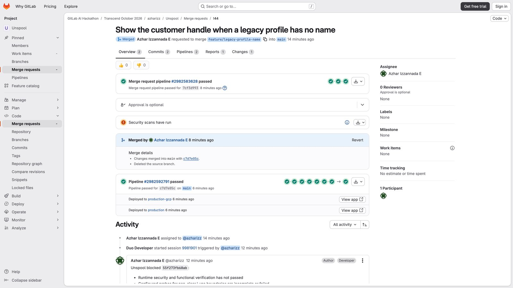 | 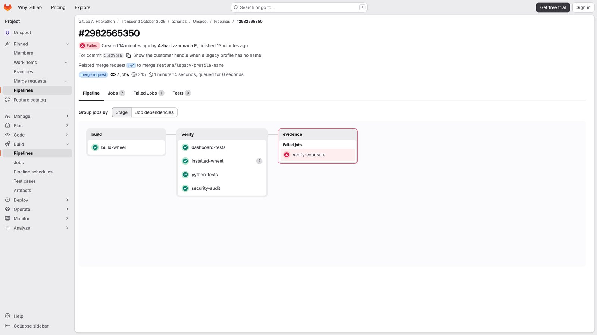 | 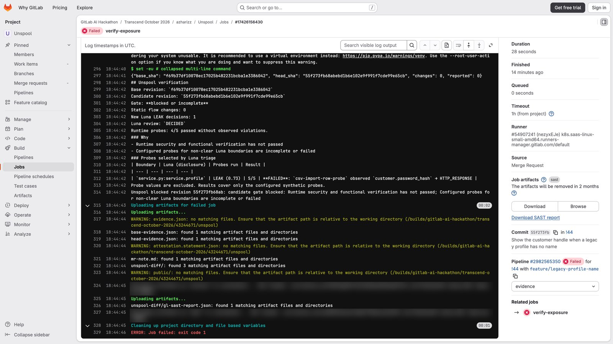 |
| Opened by one `git push`; no issue, no label. | Every test passes. One check does not. | The boundary, the probe, the field and where it left. |

| Duo started through the API | Duo's commit, same branch | The fix |
| --- | --- | --- |
| 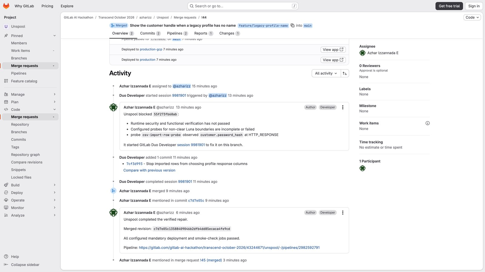 | 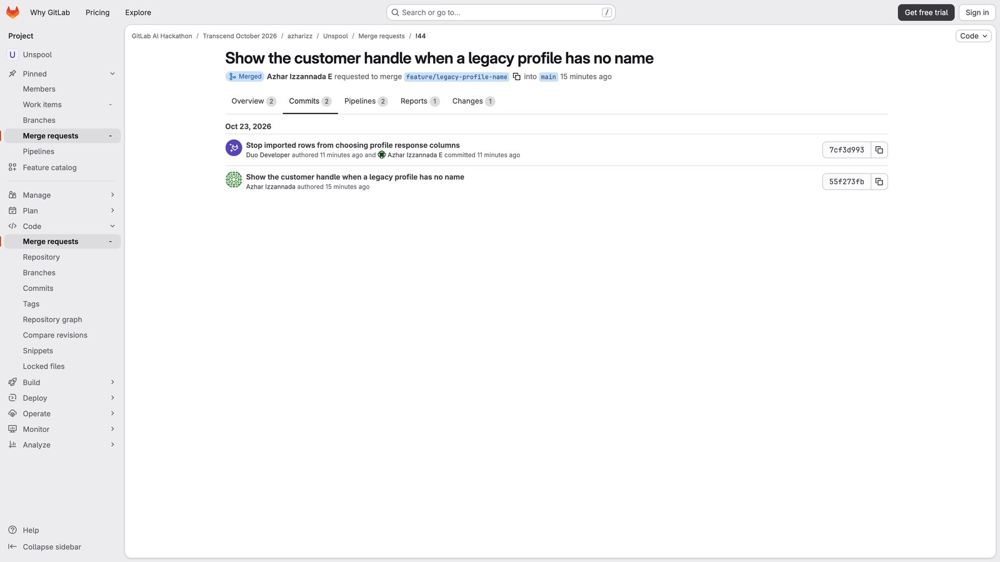 | 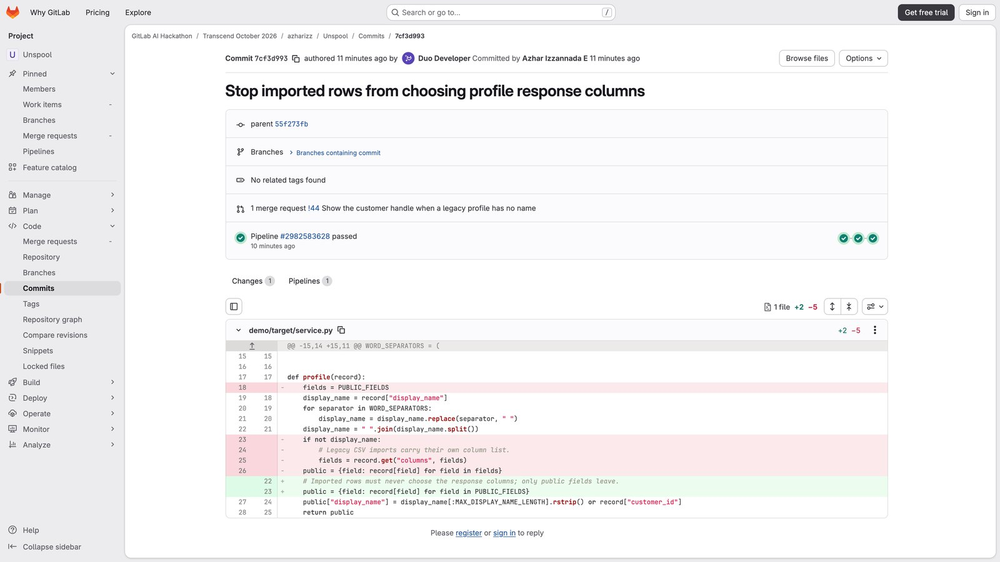 |
| A plain record of what the controller did; no mention triggers anything. | Authored by Duo Developer, on the developer's branch. | Only public fields can leave, whatever the record carries. |

| The probes decide | Merged by the controller | Live, exact revision |
| --- | --- | --- |
| 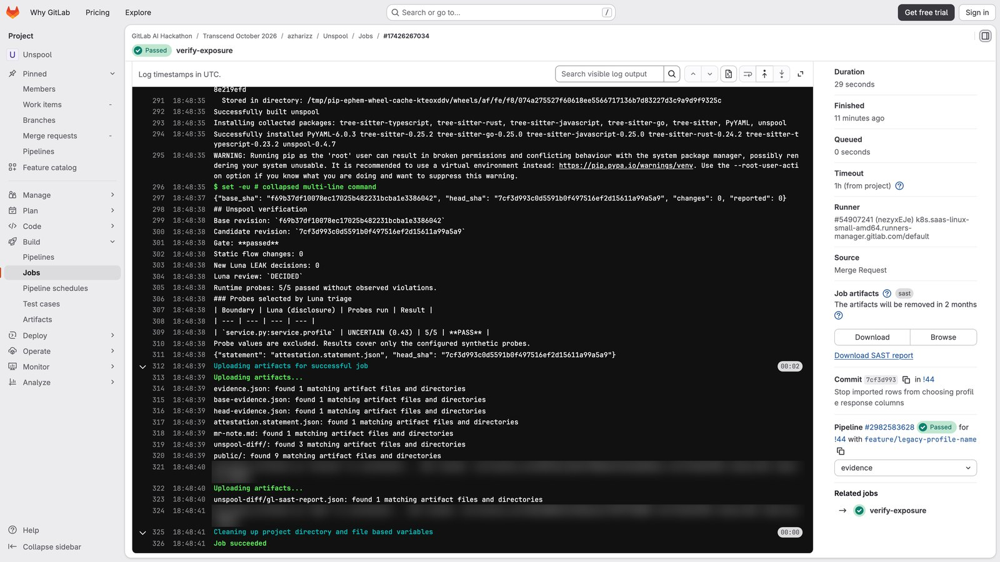 |  | 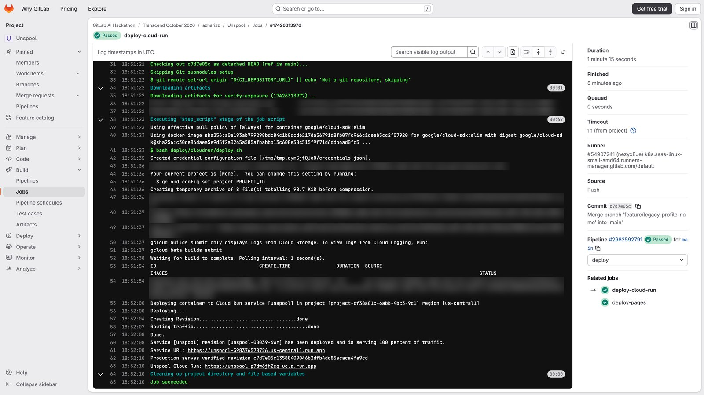 |
| The model is still unsure, so the probes run again. Nothing leaks. | After every required job and the signed evidence pass. | Cloud Run serves exactly the merged commit. |

An issue works too: [issue #6](https://gitlab.com/gitlab-ai-hackathon/transcend-october-2026/43244671/unspool/-/work_items/6), labelled `unspool`, went from creation to a verified deployment through [MR !39](https://gitlab.com/gitlab-ai-hackathon/transcend-october-2026/43244671/unspool/-/merge_requests/39) in about 7 minutes.

## How Unspool decides

<table>
  <tr>
    <td width="50%">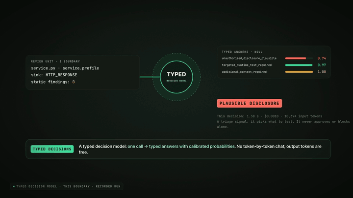<br><sub><strong>A typed decision model.</strong> One call per boundary, typed answers with probabilities, no chat. From 180 ms (provider page), 1.11–1.38 s measured here, about $1 per 1,000 decisions.</sub></td>
    <td width="50%">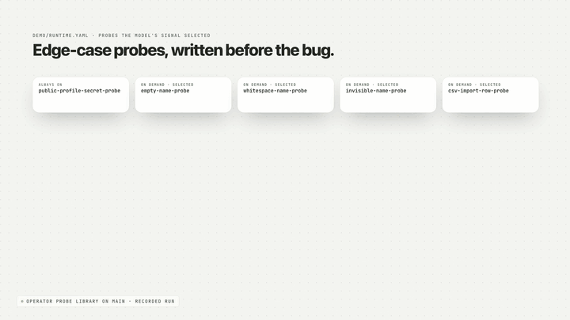<br><sub><strong>Probes written before the bug.</strong> A legacy import row carries a fake secret, a canary. It comes back in the response: proven, not guessed.</sub></td>
  </tr>
</table>

| Signal | What it contributes | What it never does alone |
| --- | --- | --- |
| **Static tracing** | Follows classified fields from source to sink (HTTP response, log, webhook, analytics, AI prompt) with a policy or the built-in catalogue. | It found zero issues in the demo leak; it is a map, not a verdict. |
| **Typed decision model** | Reads only the boundaries that changed and answers three typed questions: plausible disclosure, runtime test required, more context required. | Approve or block. It picks what to test. |
| **Canary probes** | Operator-written edge cases (empty, whitespace, invisible and legacy-import names) run in isolation with synthetic secrets. | Run on real data. Values never leave the job; logs carry symbols, not secrets. |
| **The gate** | Blocks when any probe observes a canary at a forbidden sink, or when required evidence is missing. | Pass on unknown. Unsupported or failed analysis blocks. |

### In the Unspool UI

| Follow the data | Ask the decision model | The probe that saw it | Duo's fix, re-tested |
| --- | --- | --- | --- |
| 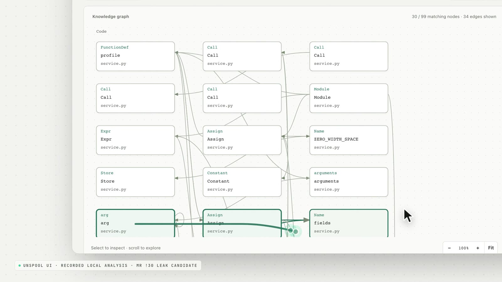 | 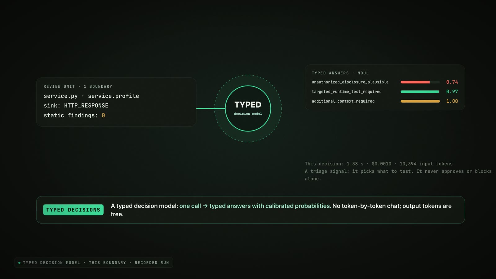 | 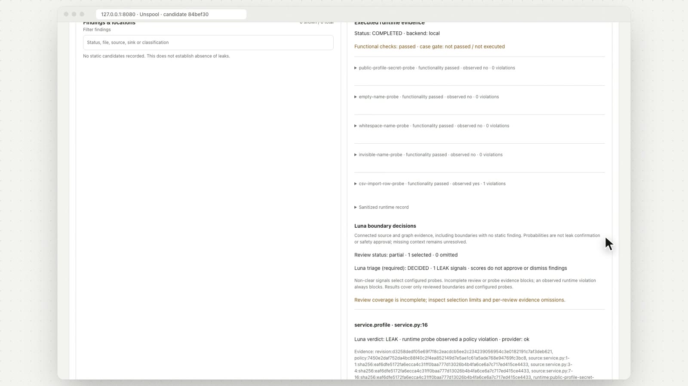 | 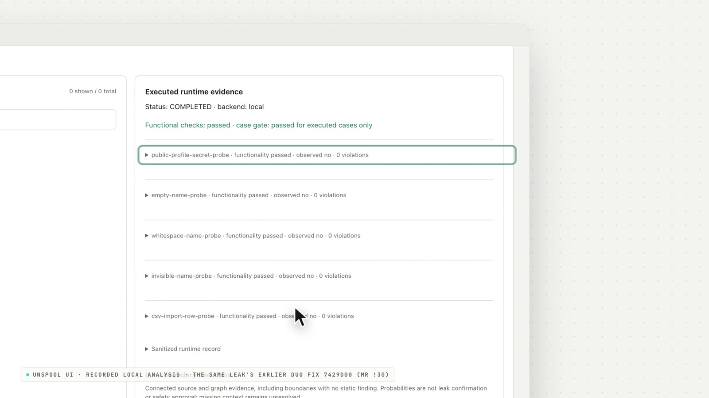 |
| The data flow as a graph you can inspect. | One call, typed answers with probabilities. | Executed probes, with the one that caught the leak. | The same probes on the fix: nothing observed. |

## What Unspool does

| | Capability | What you get | How it is built |
| --- | --- | --- | --- |
| 🧵 | **Exposure tracing in five languages** | Every sensitive field, from where it is born to where it leaves. | Python AST analysis plus Tree-sitter adapters for JavaScript, TypeScript, Go and Rust, with policy-classified sources and sinks and per-language runtime probes. |
| 🛡️ | **Proven, not guessed** | A merge request blocked only by evidence it can show you. | Isolated runtime probes with canaries; `verify-exposure` writes `evidence.json`, a verdict note and a diff of exposures. |
| 🤖 | **Duo fixes the same MR** | The leak fixed on the developer's own branch. | Duo Agent Platform API (`developer/v1`) started by the controller with the verdict; no @-mention trigger. |
| 🚦 | **Hands-off promotion** | Merge, deploy and live check without a person. | `python3 -m unspool.handoff --watch`: exact-revision, allowlisted, required-jobs and signed-evidence checks before merging. |
| ✍️ | **Signed evidence** | A record anyone can verify. | Sigstore `cosign` signing and attestation on protected `main`; the controller refuses to merge without the verifier. |
| ☁️ | **Delivery on Google Cloud** | A read-only report on Cloud Run, Pages as fallback, both checked live. | Cloud Build + Cloud Run with Workload Identity Federation; no service-account keys in CI. |
| 🔎 | **A graph you can read** | The data flow, findings, probes and decisions in one place. | The Unspool UI ([live, read-only demo](https://unspool-demo-398376578726.us-central1.run.app)), with immutable snapshots and annotations locally. |
| 🧾 | **Policy optional** | Works with no policy file; exact with one. | A built-in sensitive-field catalogue; `extends: builtin` layers your own rules on top. |

<table>
  <tr>
    <td width="50%">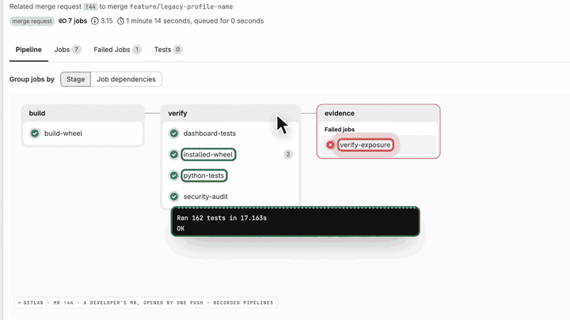<br><sub><strong>Every test passes. One check doesn't.</strong> The gate blocks MR !44 and shows exactly why.</sub></td>
    <td width="50%">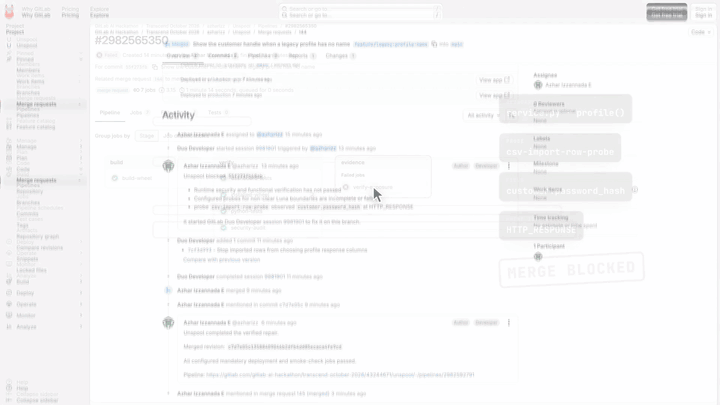<br><sub><strong>Duo fixes the same merge request.</strong> Started through the Agent Platform API, on the same branch.</sub></td>
  </tr>
  <tr>
    <td width="50%">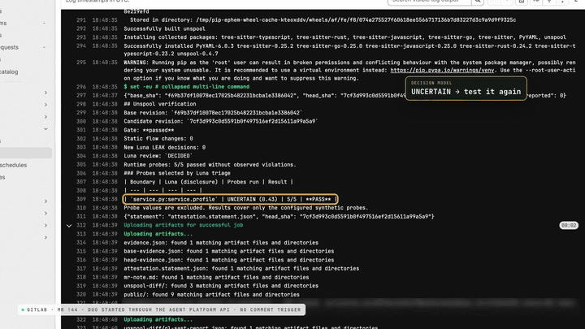<br><sub><strong>Verified and live.</strong> Gate passed, merged by the controller, the exact revision serving on Cloud Run.</sub></td>
    <td width="50%"><br><sub><strong>What actually leaves.</strong> One service, five ways out.</sub></td>
  </tr>
</table>

## Results

| Measure | Result | Where |
| --- | --- | --- |
| Hands-off developer MR | One push to `DEPLOYED_AND_VERIFIED` in ~8.5 min, untouched | [MR !44](https://gitlab.com/gitlab-ai-hackathon/transcend-october-2026/43244671/unspool/-/merge_requests/44) |
| Hands-off issue | Labelled issue to `DEPLOYED_AND_VERIFIED` in ~7 min, untouched | [Issue #6](https://gitlab.com/gitlab-ai-hackathon/transcend-october-2026/43244671/unspool/-/work_items/6) → [MR !39](https://gitlab.com/gitlab-ai-hackathon/transcend-october-2026/43244671/unspool/-/merge_requests/39) |
| 36 agent-written fixes (12 tasks × 3 runs) | 14 still leaked after passing their own tests; **14/14 blocked**; **22/22** clean fixes passed | [`benchmarks/gate_experiment`](benchmarks/gate_experiment) |
| Determinism | 10 runs per revision on the same leak (MR !30's revisions): the same verdict every time (leak 0.74 blocked 10/10; Duo's fix 0.49 passed 10/10) | [`benchmarks/gate_experiment`](benchmarks/gate_experiment) |
| Five languages | 50 synthetic holdout checks: runtime probes 10/10 for each of Python, JavaScript, TypeScript, Go and Rust (local and Docker); static recall 100%, with four false positives outside Python | [technical notes](submission/technical-notes.md) |
| Test suite | 162 tests on Python 3.10 and 3.12, dashboard checks, installed-wheel verification | [CI pipelines](https://gitlab.com/gitlab-ai-hackathon/transcend-october-2026/43244671/unspool/-/pipelines) |

<p align="center">
  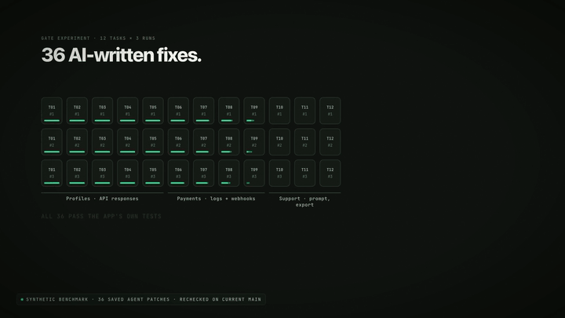
</p>

## Nine DevSecOps stages

Every stage of [GitLab's DevSecOps lifecycle](https://about.gitlab.com/topics/devops/#the-dev-ops-lifecycle-and-how-dev-ops-works) is touched by the loop:

| Stage | Where Unspool touches it |
| --- | --- |
| **Plan** | Labelled-issue intake: an `unspool` issue becomes a bounded task for Duo. |
| **Create** | GitLab Duo's Developer flow writes the fix on the merge request's branch. |
| **Verify** | Unit, dashboard and installed-wheel tests; the `verify-exposure` gate with canary probes. |
| **Package** | `build-wheel` builds the distributable; [release 0.4.7](https://gitlab.com/gitlab-ai-hackathon/transcend-october-2026/43244671/unspool/-/releases/v0.4.7) keeps the wheel and verification bundle. |
| **Secure** | Exposure gate, `security-audit` (bandit + pip-audit), signed evidence and attestation. |
| **Release** | Exact-revision verified merge by the controller; protected `main`. |
| **Configure** | Cloud Run and Pages delivery from CI, Workload Identity Federation, operator-owned controller configuration. |
| **Monitor** | `production-smoke` and the controller's live `health.json` check of the exact deployed revision. |
| **Govern** | File allowlist, required-job list, stop-on-unknown, bounded Duo retries, a private resumable run journal, MIT licensing. |

## Path B: before and after

Unspool began as **LeakHunter**, an MIT-licensed open-source CLI: [github.com/azharizz/leakhunter](https://github.com/azharizz/leakhunter) (first commit `3e8c0af`, MIT in `c6ab65f`). It was imported to GitLab with its history and rebuilt around GitLab's lifecycle during the hackathon.

| | Before: LeakHunter | After: Unspool on GitLab |
| --- | --- | --- |
| **Finding a leak** | Run a local CLI by hand; read a report. | Every merge request runs the exposure gate in GitLab CI. |
| **Proving it** | Static findings and judgement. | Typed decision model + canary probes; evidence attached to the pipeline. |
| **Fixing it** | A developer reads the report and patches it. | GitLab Duo fixes it on the same branch, started automatically with the evidence. |
| **Shipping it** | Manual merge and deploy, if anyone remembers. | Verified merge, signed evidence, Cloud Run deploy, live-revision check. |
| **Trust** | "It passed on my machine." | Exact revision, required jobs, independent evidence, stop on anything unknown. |

## How the system is built

<p align="center">
  
</p>

### Where it runs

| Component | Where | Role |
| --- | --- | --- |
| **Unspool controller** | The operator's machine (`python3 -m unspool.handoff --watch`) | Watches merge requests and labelled issues, starts GitLab Duo when the gate blocks, merges only verified revisions, confirms the live revision. Uses the operator's `glab` login and `cosign`. |
| **GitLab CI/CD** | GitLab.com shared runners | Tests, wheel, security audit, the `verify-exposure` gate; on protected `main`: signing, attestation, delivery, smoke. |
| **GitLab Duo Developer flow** | GitLab Duo Agent Platform, on a GitLab runner | Writes the fix on the MR's branch as the Duo service account; cannot merge. |
| **Typed decision model** | Third-party API, called only by `verify-exposure` | One call per changed boundary; picks which probes to run. |
| **Workload Identity Federation** | Google Cloud IAM (pools `unspool-exposure-ci`, `unspool-gitlab`) | GitLab OIDC in place of service-account keys: one pool may only read the model key, the other may only deploy from protected `main`. |
| **Secret Manager** | Google Cloud | Holds the decision-model API key; released only to this project's pipelines. |
| **Cloud Build → Artifact Registry** | Google Cloud, `us-central1` | Builds the report image for each merged commit. |
| **Cloud Run `unspool`** | Google Cloud, `us-central1`, scales to zero (max 1) | The read-only verified report; its `health.json` names the exact merged commit the controller checks. [Open](https://unspool-398376578726.us-central1.run.app) |
| **Cloud Run `unspool-demo`** | Google Cloud, `us-central1`, scales to zero (max 2) | The read-only Unspool UI with recorded runs. [Open](https://unspool-demo-398376578726.us-central1.run.app) |
| **GitLab Pages** | GitLab.com (`unspool-site`) | The fallback report, published only from passed evidence. [Open](https://unspool-site-1032c3.gitlab.io) |
| **Unspool UI (local)** | `python -m unspool` on any machine | The full app: graph, findings, probes, snapshots and annotations. |

### Code layout

| Layer | Responsibility |
| --- | --- |
| [`unspool/`](unspool/) | The analyzer, runtime probes, decision-model client, gate, UI and API (`python -m unspool`), and the hands-off controller (`unspool.handoff`). |
| [`.gitlab-ci.yml`](.gitlab-ci.yml) | Tests, wheel build, security audit, `verify-exposure`, signing, attestation, Cloud Run and Pages delivery, production smoke. |
| [`.gitlab/duo/`](.gitlab/duo/) | The GitLab Duo agent configuration used by the Developer flow's runner. |
| [`templates/verify/`](templates/verify/) | A reusable CI template that adds the exposure gate to another project. |
| [`config/`](config/) | Operator-owned controller configurations: project, allowlist, required jobs, mode. |
| [`deploy/cloudrun/`](deploy/cloudrun/) | Cloud Build and Cloud Run deployment of the read-only report, keyless via Workload Identity Federation. |
| [`deploy/demo-ui/`](deploy/demo-ui/) | The read-only live demo of the UI on Cloud Run (scales to zero). |
| [`demo/`](demo/) | The synthetic target service, its policy and its probe library. |
| [`benchmarks/`](benchmarks/) | The 36-patch gate experiment, CVE cases, external targets and isolation checks. |
| [`tests/`](tests/) | 162 unit and integration tests, including the controller's hands-off paths against a fake GitLab. |

## Try it

- **Live report on Google Cloud Run:** [unspool-398376578726.us-central1.run.app](https://unspool-398376578726.us-central1.run.app) (Pages fallback: [unspool-site-1032c3.gitlab.io](https://unspool-site-1032c3.gitlab.io)).
- **Read-only UI demo:** [unspool-demo-398376578726.us-central1.run.app](https://unspool-demo-398376578726.us-central1.run.app). Pick *Leak*, *Duo fix* or *No policy* and press Analyze.
- **The proof run:** [MR !44](https://gitlab.com/gitlab-ai-hackathon/transcend-october-2026/43244671/unspool/-/merge_requests/44) and its [pipelines](https://gitlab.com/gitlab-ai-hackathon/transcend-october-2026/43244671/unspool/-/merge_requests/44/pipelines).
- **A guided local walkthrough:** [JUDGE_GUIDE.md](JUDGE_GUIDE.md).

## ⚡ Run locally

Requirements: Python 3.10+, Git, Docker for isolated probes, and `AGENT_PROVIDER_API_KEY` for the decision model.

```sh
python3 -m pip install .
unspool --repository demo/target --policy demo/policy.yaml \
        --runtime-manifest demo/runtime.yaml --data-dir /tmp/unspool-state
# open http://127.0.0.1:8787
```

Hands-off on a GitLab project (needs an authenticated `glab` and `cosign`):

```sh
python3 -m unspool.handoff --project 87860005 --watch unspool      # this project
python3 -m unspool.handoff --config my-project.json --watch unspool  # another project
```

Leave it running: any merge request to `main` whose pipeline starts while it watches, and any open issue labelled `unspool`, goes through the loop. Adopting another repository: [ADOPTION.md](ADOPTION.md).

## Verify

```sh
python3 -B -m unittest discover -s tests          # 162 tests
node --check unspool/static/app.js && node tests/test_dashboard.cjs
```

The [technical notes](submission/technical-notes.md) keep the detailed implementation record; [TEST_VERIFICATION.md](TEST_VERIFICATION.md) and [RELEASE.md](RELEASE.md) keep the dated verification history.

## Truth boundaries

- **The controller runs on the operator's machine.** It uses their existing `glab` login, the only identity allowed to merge; GitLab Duo's runtime cannot merge into `main`. "Walk away" means the watcher keeps running.
- **The decision model is a third-party API** (a typed decision model over OpenRouter). It only chooses what to test; probes decide. GitLab Duo writes every fix.
- **Duo is started through the Agent Platform API by the controller.** GitLab records that start under the operator's account, because that is the identity making the call.
- **The demo target is synthetic.** `demo/target/service.py` is small on purpose, and automatic promotion is limited to the files an operator allowlists.
- **Five languages work; real-project validation is next.** Analysis and runtime probes run on Python, JavaScript, TypeScript, Go and Rust and are measured on synthetic holdouts. Automatic repair promotion is enabled for Python until the other four are validated on real projects.
- **Probes cover what they are written for.** A passing gate means the configured probes saw nothing at a forbidden sink, not that every path is safe. Human security review still matters.
- **"In parallel ≈ 1 second" is a projection.** Unspool calls the decision model one boundary at a time today; per-decision latency and cost are measured.
- **The benchmark is synthetic.** The 36 patches come from 12 synthetic tasks; the numbers apply to those runs.

## Repository map

| Path | Purpose |
| --- | --- |
| [`submission/submission-description.md`](submission/submission-description.md) | Devpost-ready project narrative. |
| [`submission/technical-notes.md`](submission/technical-notes.md) | Detailed implementation notes (the previous README). |
| [`submission/assets/`](submission/assets/) | README banner, film excerpts and their generator. |
| [`submission/screenshots/`](submission/screenshots/) | GitLab captures from MR !44 and stills of the Unspool UI. |
| [`JUDGE_GUIDE.md`](JUDGE_GUIDE.md) · [`ADOPTION.md`](ADOPTION.md) | Local walkthrough · installing on another project. |
| [`THREAT_MODEL.md`](THREAT_MODEL.md) · [`SECURITY.md`](SECURITY.md) | Trust boundaries, unresolved risks, reporting. |
| [`AGENTS.md`](AGENTS.md) | The automation boundary GitLab Duo works within. |

## License and attribution

Unspool is licensed under [MIT](LICENSE). It is the renamed LeakHunter project, originally published at [github.com/azharizz/leakhunter](https://github.com/azharizz/leakhunter); `leakhunter` imports and the `leakhunter` command remain compatible.

- The banner is generated from [`submission/assets/src/readme-art.html`](submission/assets/src/readme-art.html) by [`submission/assets/generate-readme-assets.py`](submission/assets/generate-readme-assets.py); the GIFs are excerpts of Unspool's own showreel, whose score is original.
- Screenshots are captures of this project's real GitLab pages from the MR !44 run; credential-shaped lines are blurred.
- Unspool is an independent project. GitLab and GitLab Duo are trademarks of GitLab Inc.; Google Cloud and Cloud Run are trademarks of Google LLC. No endorsement is implied.
