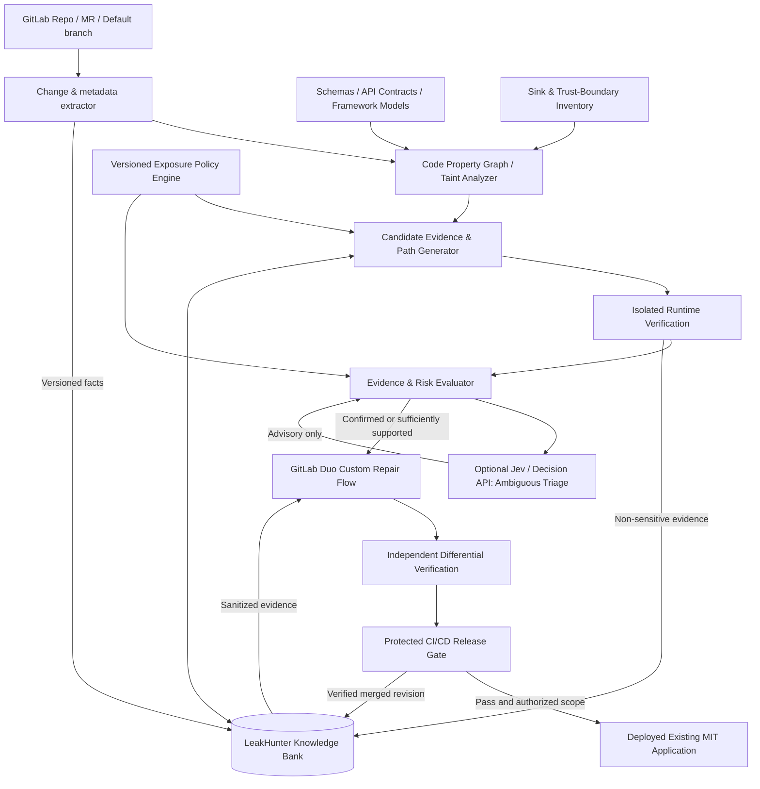

# LeakHunter — System Design and Architecture

**Status:** Proposed architecture, not an implemented GitLab or Joern feature.  
**Target:** GitLab Transcend, Path B / Hands-off, conditional on meeting its existing MIT application requirements.  
**Core idea:** Detect sensitive-data exposure across multiple application boundaries, prove representative findings in isolated runtime tests, have GitLab Duo create repairs, and verify patches independently before any automated release.

## 1. Product boundaries

LeakHunter is **not** a generic SAST replacement, a secret grepper, a security chatbot, or an LLM empowered to approve its own fixes. Its specialty is *data exposure with path and recipient context*.

For each finding, LeakHunter asks:
1. **What** information may be sensitive? (field schema and classification)
2. **Where did it come from?** (source)
3. **How did it travel?** (code property graph / taint path)
4. **Where was it sent?** (sink / destination)
5. **Who can receive it?** (role, tenant, trust boundary, permissions)
6. **Is the transfer permitted?** (versioned policy)
7. **Was it observed in an executed test?** (runtime evidence)
8. **Did the repair remove the exposure without breaking functionality?** (differential validation)

Static paths are *possible exposures*, not automatic proof of exploitability. A negative synthetic test does not prove absence of a leak on unexecuted paths.

## 2. Exposure surfaces and detection strategy

| Surface | Example | Static check | Runtime verification |
|---|---|---|---|
| Application logs | User object dumped in a logger | Source → logger argument | Capture logging output with synthetic PII |
| REST/GraphQL | `password_hash` included in response | Source → serializer → HTTP response | Assert forbidden fields absent |
| Cross-user access | Tenant A can read Tenant B invoice | Endpoint → data access, guard discovery | Two-user/two-tenant authorization test |
| Server-rendered HTML | Private fields in hydration payload | Source → SSR serialization | Browser/HTML capture |
| URLs and redirects | Credentials in query parameter | Source → URL builder | Inspect redirect URLs and query strings |
| Error monitoring | Whole request sent as error context | Source → exception reporter SDK | Intercept SDK/network payload |
| Traces/metrics | Sensitive span attributes | Source → telemetry API | Capture spans before exporter |
| Third-party analytics | User PII sent to marketing provider | Source → external SDK/HTTP | Intercept and inspect requests |
| Webhooks | Internal fields sent to partners | Source → event serializer → HTTP | Contract tests per recipient |
| Queues and event streams | Sensitive payroll data sent to broad topic | Source → producer publish | Inspect isolated broker payload |
| Exports/files | Hidden salary columns in CSV | Source → report builder → file | Generate and inspect synthetic export |
| CI artifacts | Sensitive fixture persisted in public artifact | CI config + artifact producers | Inspect isolated job artifacts and permissions |
| Cloud storage/backups | Private object stored with public grants | Source → storage client + IaC policy | Check ACL/policy using test resources |
| AI prompts | Customer records sent to unapproved model vendor | Source → model client | Capture provider-bound requests |
| Browser storage/cache | Access token placed in localStorage | Source → browser storage | Browser storage inspection |
| Notifications/email | Private record emailed to incorrect role | Source → template and recipient resolution | Mailtrap-style captured synthetic mail |
| Debug endpoints | Production debug route exposes session state | Route inventory and serialization | Role-based endpoint probe |

**MVP:** application logs/telemetry, API property exposure, and analytics/webhook egress. Stage 2: authorization, SSR, exports, and CI artifacts. All testing uses synthetic fixtures and restricted test systems.

## 3. System architecture



**Separation of responsibility**
- Static engine **finds potential information paths**; not a perfect proof engine.
- Policy engine **decides allowed versus forbidden transfers**; versioned and locked independently of repair branches.
- Runtime verifier **tests representative paths** with synthetic records and explicit recipient/role fixtures.
- Optional Jev **classifies ambiguous, sanitized summaries**; it cannot turn a confirmed violation into a pass or change policy.
- GitLab Duo **writes code changes and security regression tests**.
- CI/CD **enforces pass/fail and deployment permissions** independently of the agent.

## 4. Data classification and policy model

Example `leakhunter-policy.yaml`:

```yaml
version: 1
classifications:
  PUBLIC: 0
  INTERNAL: 1
  PERSONAL: 2
  SECRET: 3
sources:
  - selector: 'model.Customer.email'
    class: PERSONAL
  - selector: 'model.Customer.password_hash'
    class: SECRET
  - selector: 'model.Customer.id'
    class: INTERNAL
sinks:
  - kind: HTTP_RESPONSE
    audience: authenticated_self
    allow: [PUBLIC, INTERNAL, PERSONAL]
    deny_fields: ['*.password_hash', '*.session_token']
  - kind: THIRD_PARTY_ANALYTICS
    audience: external_vendor
    allow: [PUBLIC]
  - kind: APPLICATION_LOG
    audience: operators
    allow: [PUBLIC, INTERNAL]
  - kind: WEBHOOK
    audience: approved_partner
    require_contract: true
invariants:
  - secret_fields_never_in_external_payloads
  - cross_tenant_reads_must_be_authorized
  - no_real_secrets_in_test_artifacts
```

This is **LeakHunter's proposed policy schema**, not Joern's, CodeQL's, or GitLab's native schema. Production policy also needs tenant identity, lawful business purpose, retention, approved vendors, and exceptions reviewed by security owners. A class label alone cannot establish authorization.

**Example of allowed versus forbidden:** An approved transactional mailer may need a customer's email for a legitimate notification, while an analytics SDK may have no authorization to receive it. Source-to-sink reachability alone cannot settle that distinction.

## 5. CPG and graph-index design

Use an established parser / analyzer such as **Joern** or applicable taint-analysis rules rather than writing a whole compiler. CPG includes AST, control flow, call edges, and data flow. Real handling of reflection, dynamic dispatch, macros, generated code, SQL, framework serializers, external libraries, and inter-service boundaries requires additional models and tests.

**Relevant logical node types:** `DATA_FIELD`, `PARAMETER`, `VARIABLE`, `METHOD`, `SERIALIZER`, `SANITIZER`, `ENDPOINT`, `ROLE_GUARD`, `HTTP_CLIENT`, `LOGGING_API`, `EXTERNAL_SDK`, `FILE_OUTPUT`, `QUEUE_PRODUCER`, `CI_ARTIFACT`.

**Useful edge types:** `FLOWS_TO`, `CALLS`, `RETURNS`, `SERIALIZES_TO`, `PROPAGATES_AS`, `SANITIZED_BY` (only if validated), `EXPORTS_TO`, `AUTHORIZES`, `TRUST_BOUNDARY_CROSSING`, `DEFINED_AT`.

The source-code graph does **not** automatically know the true policy or runtime identity. Keep these as attached, versioned metadata rather than invented static facts.

**Index strategy:** Store the analyzer's native snapshot as a compressed artifact keyed by commit SHA and parser version. Keep lightweight `source → sink` paths, fingerprints, classifications, and evidence references in Postgres. **No Neo4j requirement** for the MVP; use specialized graph storage later only if query and scale demands justify it.

## 6. Knowledge Bank — logical data model

| Relation | Essential fields | Purpose |
|---|---|---|
| `repo_snapshots` | repo, revision_sha, parent_sha, parser_version, schema_version, policy_version, status | Immutable analysis snapshot |
| `symbols` | snapshot_id, symbol_id, path, line, type, hash | Stable-ish source locations |
| `sensitive_sources` | symbol_id, data_category, provenance, classification_policy | Known/derived sensitive fields |
| `sink_inventory` | symbol_id, sink_type, trust_zone, recipient_class | Known egress surfaces |
| `flow_paths` | fingerprint, source_id, sink_id, path_summary, static_status | Candidate propagation |
| `security_policies` | policy_version, signatures, approval_status | Authorized transfers and invariants |
| `findings` | finding_id, revision_sha, fingerprint, status, severity, policy_rule | Durable lifecycle state |
| `evidence` | finding_id, kind, storage_ref, test_sha, verifier_version | Sanitized runtime/static proof |
| `repairs` | finding_id, mr_iid, patch_sha, verification_id, disposition | Duo patch audit trail |
| `analysis_dependencies` | symbol_id, dependent_symbol_id, dependency_kind | Incremental invalidation |

**Do not put secrets or full production payloads in the Knowledge Bank.** Store schema names, paths, sanitized summaries, hashes where appropriate, and expiring links to access-controlled test evidence.

## 7. Incremental update algorithm

1. Build an immutable trusted snapshot from the protected default branch (`S0`).
2. On an MR, compare changed files and semantic symbols with `S0`.
3. Recompute changed syntax/functions and invalidate affected callers, callees, data-flow summaries, serializers, and impacted sinks.
4. Requery source-to-sink paths within this impact cone, plus all security-critical sinks affected by policy/model changes.
5. Run isolated synthetic proof tests for high-value findings.
6. Save a temporary MR overlay (`S0 + MR`), **not** an overwrite of the trusted snapshot.
7. Once the merge and all gates succeed, build/publish the exact merged SHA as `S1`, atomically update the branch pointer, and keep previous snapshots for audit/rollback.
8. Run periodic full reconciliation and full scans on analyzer, source classification, sanitizer, policy, framework, or dependency-version changes.

**Warning:** Only rescanning modified files misses changes propagated through unchanged code. Invalidation must be dependency-aware. Analyzer precision and a periodic full reconciliation are essential.

## 8. Finding and evidence contract

```json
{
  "finding_id": "LH-104",
  "revision_sha": "abc123",
  "data": {"symbol": "Customer.password_hash", "classification": "SECRET"},
  "source": {"file": "app/models/customer.py", "symbol": "Customer.password_hash"},
  "sink": {"type": "HTTP_RESPONSE", "endpoint": "GET /customers/{id}", "audience": "authenticated_user"},
  "policy": {"version": "v1", "rule": "secret_fields_never_in_external_payloads"},
  "path_summary": ["load_customer", "serialize_customer", "return_json"],
  "static_result": "POSSIBLE_FLOW",
  "runtime_evidence": {"kind": "SYNTHETIC_FIXTURE", "observed": true, "test_id": "test_private_customer_fields"},
  "status": "CONFIRMED_IN_TEST",
  "recommended_action": "DUO_REPAIR"
}
```

A separate authorization finding must include the **identity, tenant, ownership, and access-policy test matrix**, not merely a CPG path. Avoid copying real credentials or actual users' records into AI prompts, MR descriptions, or public artifacts.

## 9. GitLab Duo repair contract and release gates

**Entry:** sanitized finding ID, commit SHA, code locations, source-to-sink path, relevant policy ID, synthetic failing test, and allowed repair scope.

**Actions:**
1. Reproduce finding in isolated test runtime.
2. Inspect code and relevant Knowledge Bank paths.
3. Implement minimal change on an agent-owned branch; do not edit release policy, scanner configuration, or baseline to suppress finding.
4. Add or update a regression test exercising the original exposure and retained functional behavior.
5. Open an MR containing explanatory evidence and a clear scope statement.
6. Independent CI runs static analysis, synthetic proof, authorization checks, functionality, security tests, and diff-based policy/config checks.
7. Deterministic release controller merges/deploys only for explicitly permitted repair categories and passing gates; otherwise stop and report.
8. Post-deployment smoke tests run using synthetic data and limited access. If a check fails, rollback or stop, and preserve the evidence.

**Safety:** A repair agent cannot approve its own policy changes, broaden allowed recipients, delete the failing test, replace a scan result, bypass protected-branch rules, or access production secrets. If the issue indicates actual production exposure, incident response may require containment, rotation, notification, deletion from downstream systems, or human action. A code patch does not undo an existing disclosure.

**GitLab implementation caution:** Custom Duo flows and trigger/API behavior are version/feature/permission dependent. Normal event triggers require human-originated actions; don't design a bot-created comment to automatically launch another flow. The hackathon's allotted account may expose a different feature set. Build around a single custom Duo repair flow started in a supported way, and let CI/CD handle the deterministic continuation. Verify API-trigger availability before relying on it.

## 10. Evaluation design

Use an independent, held-out suite with labeled **positive leaks**, **safe transfers**, **authorized transfers**, **sanitized flows**, **unexercised potential paths**, and **cross-user failures**.

| Metric | Definition |
|---|---|
| Detection recall | TP / (TP + FN) on seeded, independently labeled scenarios |
| Finding precision | TP / (TP + FP) with policy and test review |
| False-safe rate | Unsafe transfers incorrectly passed by the policy/decision layer |
| Runtime confirmation rate | Static findings reproduced in representative test cases |
| Repair success | Correct verified repairs / attempted supported repair cases |
| Policy preservation | Existing allowed behaviors still work after patch |
| Incremental scan time | MR scan wall time versus full re-index time |
| Coverage visibility | Explicit supported sinks/languages and unknown paths |

Baseline comparisons: regex-only, sink rules without full paths, static taint only, and full system with runtime proof. If using Jev, compare with a deterministic ambiguity router and measure the cost/error introduced by inference.

## 11. Recommended implementation stack

- **Existing Path B application:** real, pre-existing MIT-licensed application (not a fresh repo presented as old).
- **MVP language:** Python/FastAPI or TypeScript/Node; choose one to start, then add another language later.
- **CPG/taint:** Joern or a suitable supported taint-analysis engine plus targeted custom source/sink models. Validate actual language coverage and license before choosing.
- **Parsing/change indexing:** Git diffs + analyzer symbols; Tree-sitter optional for selective syntax indexing.
- **Knowledge Bank:** Postgres with JSONB + compressed versioned graph artifacts in object storage.
- **Policy engine:** deterministic YAML rules, versioned separately and protected.
- **Runtime:** Docker Compose test environment; captured logs, HTTP responses, SDK/egress traffic, test artifacts.
- **AI:** GitLab Duo custom repair flow; Jev/Decision API only as optional advisory for ambiguous *sanitized* findings.
- **Output:** GitLab MR comments / CI reports / JSON findings, optional SARIF integration if entitled.

**GitLab SARIF caution:** GitLab's native SARIF ingestion is tied to Ultimate, so JSON/CI artifacts and MR notes are a safer MVP baseline if hackathon entitlements are uncertain.

## 12. Build scope for a short hackathon

1. Existing MIT application with three controlled bugs: (a) API overexposes a secret field, (b) logging emits synthetic PII, (c) analytics SDK exports private fields.
2. Targeted taint rules and schema labels create three source-to-sink findings with path evidence.
3. Runtime fixtures reproduce each exposure through response capture, logging capture, and fake analytics server.
4. Knowledge Bank persists graph summaries and snapshots; second MR demonstrates affected-path recomputation.
5. One GitLab Duo flow repairs at least one finding and generates a regression test; prioritize all three if time permits.
6. Independent CI verifies each repair, blocks attempts to relax policies, and deploys when allowed.
7. Final demo: baseline vulnerable → evidence trace → Duo MR patch → failing-then-passing differential tests → healthy live deployment.

**Don't claim:** exhaustive codebase understanding, complete dynamic-language support, perfect declassification, complete protection from leaks, or proof that a benign runtime test covers all possible execution paths.

## 13. Suggested Git repository layout

```text
leakhunter/
  existing-app/                # pre-existing MIT application, imported/preserved history
  leakhunter/
    analyzers/                 # CPG adapter and source/sink rules
    classifiers/               # schema sensitivity extraction
    policy/                    # exposure policy evaluation
    knowledge_bank/            # snapshots, dependency invalidation, finding lifecycle
    runtime/                   # synthetic evidence harnesses
    evidence/                  # evidence normalization, no raw secrets
    repair/                    # safe Duo input generation
  policies/leakhunter-policy.yaml
  framework-models/
  duo-flows/leakhunter-repair.yaml
  tests/exposure_fixtures/
  tests/authorization/
  .gitlab-ci.yml
  docs/architecture.md
  docs/threat-model.md
  LICENSE
```

## 14. Research references

- [Joern Code Property Graph](https://docs.joern.io/code-property-graph/)
- [CodeQL data-flow analysis](https://codeql.github.com/docs/writing-codeql-queries/about-data-flow-analysis/)
- [OWASP API3: Broken Object Property Level Authorization](https://api-security.owasp.org/editions/2023/en/0xa3-broken-object-property-level-authorization/)
- [OWASP API1: Broken Object Level Authorization](https://api-security.owasp.org/editions/2023/en/0xa1-broken-object-level-authorization/)
- [OWASP Logging Cheat Sheet](https://cheatsheetseries.owasp.org/cheatsheets/Logging_Cheat_Sheet.html)
- [OpenTelemetry Collector telemetry transformation](https://opentelemetry.io/docs/collector/transforming-telemetry/)
- [GitLab Custom Flows](https://docs.gitlab.com/user/duo_agent_platform/flows/custom/)
- [GitLab Flow Triggers](https://docs.gitlab.com/user/duo_agent_platform/triggers/)
- [GitLab SARIF reports](https://docs.gitlab.com/user/application_security/detect/sarif/)
- [GitLab Agentic SAST Vulnerability Resolution](https://docs.gitlab.com/user/application_security/vulnerabilities/agentic_vulnerability_resolution/)
